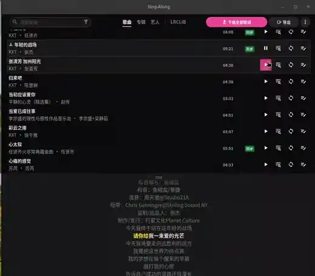

# Sing-Along

Sing-Along is a free, open-source desktop music player with synced lyrics for
music you already own. It plays your local files, downloads matching lyrics,
lets you fix the timing, and exports those lyrics in the formats your phone and
car actually understand.

It is built with Tauri v2 (Rust + Vue 3), runs on Linux, and is licensed MIT.

- **What it does:** batch-downloads synced lyrics, edits line- and word-level
  timing, converts between Simplified and Traditional Chinese, exports to LRC,
  enhanced LRC (A2) and TTML
- **Lyric sources:** [LRCLIB](https://lrclib.net) (primary) and NetEase
  (optional fallback)
- **Platform:** Linux `.deb`, amd64
- **Not a music manager:** no streaming, no metadata scraping, no library
  curation beyond a play queue
- **Free:** no subscription, no paid tier, MIT licensed

Sing-Along scans the folders you choose and saves lyrics next to your audio
files or embeds them in the tags. It began as a fork of
[LRCGET](https://github.com/tranxuanthang/lrcget) and has since diverged — see
[Independent project](#independent-project).

## Demo

Lyrics scrolling in time with the playing track, then the library list behind it:



## What it does

**Find lyrics for a whole library.** Batch download with skip rules — overwrite
everything, fill only tracks missing synced lyrics, or only tracks with no lyrics
at all — chosen per download rather than as a global setting.

**Sync a single track.** Every row in the library has a sync button that runs the
same pipeline for one song, so a fix does not mean re-downloading an album.

**Fix timings by ear.** Play a track and correct it line by line, or word by
word. A keyboard shortcut stamps a line with the current playback position, so
the usual loop is: play, hear it drift, press a key.

**Convert between Simplified and Traditional Chinese.** Conversion is offered at
download time and remembered, because it is lossy in both directions: `发` is
`發` (as in 發財) or `髮` (as in 頭髮), and only context decides. Off by default.

**Export to what your phone actually reads.** The Export menu writes the whole
library out as plain text, LRC, enhanced LRC (A2) for Android players, or TTML
for iOS players — in any combination — either as sidecar files or embedded into
the audio tags.

**Fetch missing album art.** Optionally searches iTunes and Deezer — both public,
no key — and writes the front cover into the audio file's tags. Off by default,
because it rewrites your files.

**Seventeen UI languages.** English, 简体中文, 繁體中文, 日本語, 한국어, Español,
Français, Deutsch, Italiano, Português (Brasil), Polski, Türkçe, Русский,
Українська, Tiếng Việt, ไทย, Bahasa Indonesia — following the system language by
default, switching live without a restart.

## Two lyric sources

| Source | What it is | Notes |
| ------ | ---------- | ----- |
| LRCLIB | Open, community-run lyric database | The default. Instance URL is configurable. |
| NetEase | China's largest music service | Fallback when LRCLIB has nothing. Non-official API — it can break, and a failure just means "no fallback lyrics found" rather than an error. |

The Search tab queries both and tags each result with where it came from. Either
source can be unticked; a source that fails does not hide the other's results.

## Why word-level lyrics need converting

Word-level lyric files are not portable. There are at least eight dialects and
only one of them (TTML) is an actual standard:

| Format                | Line timing | Word timing | Defined by                                                  |
| --------------------- | ----------- | ----------- | ----------------------------------------------------------- |
| LRC                   | ✅          | ❌          | a 1998 Winamp plug-in, never standardised                   |
| LRC A2 (Enhanced LRC) | ✅          | ✅          | the A2 Media Player author                                  |
| SPL                   | ✅          | ✅          | the Salt Player author                                      |
| YRC / QRC / KRC       | ✅          | ✅          | NetEase / QQ Music / Kugou (the last two are **encrypted**) |
| TTML                  | ✅          | ✅          | W3C (started as DFXP in 2003)                               |

So the same library has to be exported twice if you use two players: enhanced
LRC for players that read the A2 extension (Gramophone, Fluxio), and TTML for
players whose word highlighting comes only from TTML (Steve on iOS).

Background, with sources, on how these formats came to exist, who owns each one,
why two of them are encrypted, and why free offline players with word-level
lyrics are so scarce:

**📖 [从「能免费在车里唱歌」出发，我为什么会撞上三种歌词格式](https://freelamp.com/articles/2026-10-18_lrc-ttml-karaoke-formats/)** (Chinese)

Standalone conversion helpers live in [`tools/`](tools/README.md) if you want
them without the app.

## How it compares

**vs LRCGET.** LRCGET is a mass-downloading utility: it fetches lyrics for a
library and stops there. Sing-Along is the same idea plus a player, a
word-level timing editor, Chinese script conversion, album art, and export to
A2 and TTML. Sing-Along is a fork of LRCGET but does not track it.

**vs a general music player** (VLC, foobar2000, MusicBee, Strawberry). Those play
audio and display whatever lyrics file already exists. Sing-Along's job is
producing and correcting that file — downloading it, timing it word by word,
converting it, exporting it for a specific player.

**vs streaming apps.** No account, no network dependency for playback, no
catalogue. Your files, your lyrics, offline.

**vs buying lyrics.** Word-level lyric timing files are not sold anywhere. Every
format in the comparison table above is either community-produced or
reverse-engineered from one of the Chinese music services.

## Who it is for

- People with a local music library (FLAC, MP3, M4A) who want lyrics that scroll,
  not static text
- Anyone who has tried to get word-by-word lyrics working on a Chinese Android
  player or an iPhone and found the file format is the problem
- Chinese-language listeners who need Simplified/Traditional conversion, or
  whose titles and artists are CJK and break naive search
- People syncing a library to a phone or car head unit and needing the lyrics
  written in a format that device reads

## Independent project

**Sing-Along is not tracking upstream.** It began as a fork of
[LRCGET](https://github.com/tranxuanthang/lrcget) and has since gone its own
way — there is no upstream remote, no pull from the original repository, and no
intent to push changes back. Bug reports and features are decided here.

That also means a few things you should not expect:

- **No parity with LRCGET.** Upstream may add features this fork never gets, and
  the other way round.
- **A different scope.** LRCGET is a mass-downloading utility. Sing-Along is a
  player that also edits and converts.
- **Upstream issues do not apply here.** If you hit something, report it in this
  repository.

## Command line

The same binary runs headless. `sing-along` with no arguments opens the player;
a subcommand does the work without a window:

```shell
sing-along fetch ~/Music                    # download missing lyrics
sing-along fetch ~/Music --script simplified
sing-along export ~/Music --for steve        # TTML for iOS
sing-along export ~/Music --for gramophone   # enhanced LRC for Android
sing-along status ~/Music                    # what a folder is missing
sing-along formats                           # list export targets
```

`man sing-along` documents all of it, including why the format has to match the
player: Steve on iOS reads word timing only from TTML, Gramophone and Fluxio only
from enhanced LRC, and sending one to the other shows the timestamps as lyric
text.

## Using it from an AI agent

The package ships a skill describing the workflow for a coding agent — the
questions to settle first, the player-to-format table, how to verify a converted
file, and the rules that matter (never rewrite lyric text; do not claim a track
can be synced when only unsynchronised text exists).

It is installed at `/usr/share/sing-along/skills/sing-along/SKILL.md`, and lives
in this repository at [`skills/sing-along/SKILL.md`](skills/sing-along/SKILL.md).

To use it with Claude Code or a similar agent, point the agent at that file, or
copy it into the skills directory the agent reads:

```shell
mkdir -p ~/.claude/skills/sing-along
cp /usr/share/sing-along/skills/sing-along/SKILL.md ~/.claude/skills/sing-along/
```

Typical requests it covers:

- "帮我把这个目录下的音乐文件的歌词补充完整"
- "把这些歌词导出成 Steve 能用的格式"
- "检查一下这个文件夹缺哪些歌词"

## Install

See [the latest release](https://github.com/LeisureLinux/Sing-Along/releases/latest)
for the current version's files.

**Linux** — `.deb` for Debian and Ubuntu, `.rpm` for Fedora and openSUSE, or the
`.AppImage` if neither applies. The AppImage needs no installation; mark it
executable and run it.

```shell
sudo apt install ./sing-along_x.y.z_amd64.deb    # Debian / Ubuntu
sudo dnf install ./sing-along-x.y.z-1.x86_64.rpm # Fedora
chmod +x sing-along_x.y.z_amd64.AppImage && ./sing-along_x.y.z_amd64.AppImage
```

**Windows** — `-setup.exe` installs it; the `.msi` is for managed deployment.

**macOS** — the `.dmg` is Apple Silicon only (M1 and later).

The Linux builds are dynamically linked against WebKitGTK, GTK 3 and ALSA, so
they need those present at runtime. A static build is not possible: distributions
ship no static WebKitGTK, and WebKitGTK loads GIO modules and font backends at
runtime even when everything else is linked in.

## If the installer is blocked

The apps are free and built by one person, so the installers are not signed with
a paid certificate. Windows and macOS show a warning because of that — not
because anything is wrong with the file.

### Windows

You will see **"Windows protected your PC"** and a line saying the publisher is
unknown.

Click **More info**, then **Run anyway**. Windows remembers the choice for that
file, so it only asks once.

### macOS

You will see one of these:

> "Sing-Along" is damaged and can't be opened. You should move it to the Trash.

> "Sing-Along" cannot be opened because the developer cannot be verified.

The app is fine — macOS says this about any app it has not seen before. The first
message is just badly worded.

**To open it:** go to **System Settings → Privacy & Security**, scroll down to the
Security section, and click **Open Anyway** next to Sing-Along. Enter your
password when asked. You only need to do this once.

If the app really does seem broken after that (it quits immediately, or nothing
happens), the download may have arrived damaged. Delete it, download again, and
if it still fails open an issue on the repository.

Drag Sing-Along into **Applications** before opening it — running it from inside
the `.dmg` does not work properly.

## Development

Stack: [Tauri](https://tauri.app) v2 — Rust backend, Vue 3 frontend, SQLite.

Two architecture notes are worth reading before changing code:
[`src/ARCHITECTURE.md`](src/ARCHITECTURE.md) for the frontend and
[`src-tauri/ARCHITECTURE.md`](src-tauri/ARCHITECTURE.md) for the backend. Both
describe the parts that are not obvious from the file names — the composable
state model, the event flow, the scanner, and the lyric-file formats.

Prerequisites: Rust 1.81+, Node 18+, plus the
[Tauri platform prerequisites](https://tauri.app/start/prerequisites/) (on
Linux: `libwebkit2gtk-4.1-dev`, `libgtk-3-dev`, `libasound2-dev`,
`build-essential`).

```shell
npm install
npm run tauri:dev
```

`npm run tauri:dev` passes `--features dev,devtools`. Plain `tauri dev` only
passes `--no-default-features`, so a debug build started that way has neither the
devtools panel nor the WebDriver bridge on `127.0.0.1:4445` — this trips people
up.

Before reporting work as done, all three must pass:

```shell
npx eslint src --include=*.js --include=*.vue
npx vitest run
cd src-tauri && cargo test
```

**Build note:** Charabia's dictionaries are downloaded at build time by its build
scripts. If that fails (network, TLS), point `LINDERA_CACHE` at a populated cache
directory and the scripts take a fast path instead of downloading.

## Building

```shell
npm install
npm run tauri build
```

Output lands in `src-tauri/target/release/` and the bundle in
`src-tauri/target/release/bundle/`.

Release builds carry no devtools and no WebDriver server: both are behind opt-in
cargo features that `tauri build` does not enable. Verify with
`cargo tree -i tauri-plugin-webdriver`, which cannot resolve the package at all
in the default feature set.

`bundle.targets` in `tauri.conf.json` lists what a plain `npm run tauri build`
produces: `deb`, `rpm`, `appimage`, `nsis`, `msi` and `dmg`. Each platform only
builds the ones it can — a Linux run skips the Windows and macOS targets — so the
list is a declaration of intent rather than a single-machine build plan.

## License and attribution

Sing-Along is a fork of [LRCGET](https://github.com/tranxuanthang/lrcget),
Copyright (c) 2023 tranxuanthang, used under the MIT License. The original
copyright notice and the MIT permission notice are retained in
[LICENSE](LICENSE); see [NOTICE](NOTICE) for full attribution and a list of what
this fork changed. The About dialog in the app carries the same credit.

## Support

Sing-Along is free, with no subscription and nothing held back behind a payment.
If it earned that, a tip is welcome — not expected.


**Thanks for your donation!**<br>
**感谢您的赞赏！**
