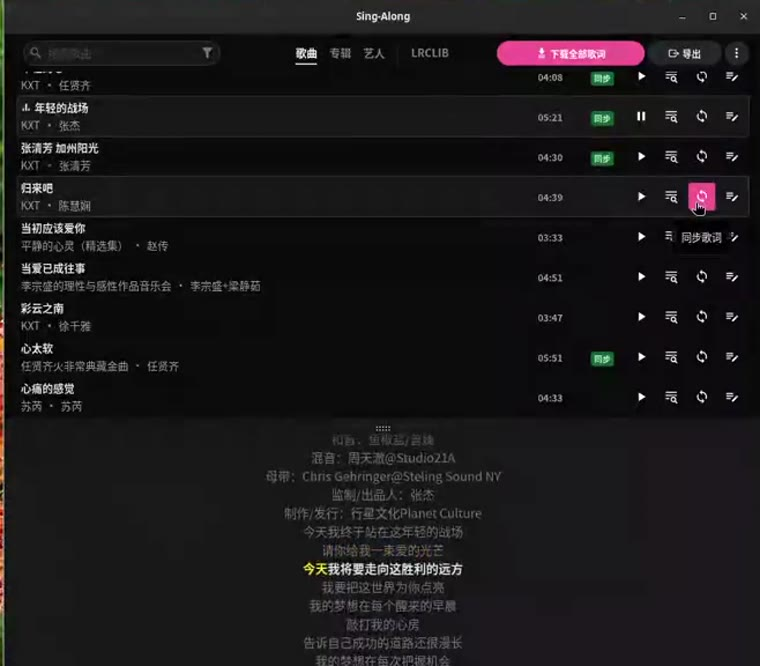

# Sing-Along

**A desktop music player with synced lyrics, built for people who keep their own
music library.** It finds, edits, converts and exports lyrics — so the same
library works on your phone, in your car, and on the players you already use.

Sing-Along scans the folders you choose, looks up matching lyrics, saves them
next to your audio files or embeds them in the tags, and lets you correct the
timings while you listen. It plays your music, but it is not a music manager:
there are no playlists to curate beyond a queue, no library metadata scraping,
no streaming.

Lyrics come from [LRCLIB](https://lrclib.net), with an optional
[NetEase](https://music.163.com) fallback.

## Demo

Lyrics scrolling in time with the playing track, then the library list behind it:

[](demo/sing-along-demo.mp4)


The animated preview loops the first ~14 seconds. Click the still above to watch
the full clip with sound ([`demo/sing-along-demo.mp4`](demo/sing-along-demo.mp4),
36 s).

GitHub strips `<video>` tags from READMEs and only inlines video uploaded through
its own editor, so the animation is a WebP — which GitHub serves as an image and
plays automatically — and the MP4 is a normal link rather than an embed.

## What it does

**Find lyrics for a whole library.** Batch download with skip rules — overwrite
everything, fill only tracks missing synced lyrics, or only tracks with no lyrics
at all — chosen per download rather than as a global setting.

**Sync a single track.** Every row in the library has a sync button that runs the
same pipeline for one song, so a fix does not mean re-downloading an album.

**Fix timings by ear.** Play a track and correct it line by line, or word by
word. A keyboard shortcut stamps a line with the current playback position, so
the usual loop is: play, hear it drift, press a key.

**Convert between Simplified and Traditional Chinese.** Conversion is offered at
download time and remembered, because it is lossy in both directions: `发` is
`發` (as in 發財) or `髮` (as in 頭髮), and only context decides. Off by default.

**Export to what your phone actually reads.** The Export menu writes the whole
library out as plain text, LRC, enhanced LRC (A2) for Android players, or TTML
for iOS players — in any combination — either as sidecar files or embedded into
the audio tags.

**Fetch missing album art.** Optionally searches iTunes and Deezer — both public,
no key — and writes the front cover into the audio file's tags. Off by default,
because it rewrites your files.

**Three UI languages.** English, 简体中文, 繁體中文, following the system language
by default.

## Two lyric sources

| Source | What it is | Notes |
| ------ | ---------- | ----- |
| LRCLIB | Open, community-run lyric database | The default. Instance URL is configurable. |
| NetEase | China's largest music service | Fallback when LRCLIB has nothing. Non-official API — it can break, and a failure just means "no fallback lyrics found" rather than an error. |

The Search tab queries both and tags each result with where it came from. Either
source can be unticked; a source that fails does not hide the other's results.

## Why word-level lyrics need converting

Word-level lyric files are not portable. There are at least eight dialects and
only one of them (TTML) is an actual standard:

| Format                | Line timing | Word timing | Defined by                                                  |
| --------------------- | ----------- | ----------- | ----------------------------------------------------------- |
| LRC                   | ✅          | ❌          | a 1998 Winamp plug-in, never standardised                   |
| LRC A2 (Enhanced LRC) | ✅          | ✅          | the A2 Media Player author                                  |
| SPL                   | ✅          | ✅          | the Salt Player author                                      |
| YRC / QRC / KRC       | ✅          | ✅          | NetEase / QQ Music / Kugou (the last two are **encrypted**) |
| TTML                  | ✅          | ✅          | W3C (started as DFXP in 2003)                               |

So the same library has to be exported twice if you use two players: enhanced
LRC for players that read the A2 extension (Gramophone, Fluxio), and TTML for
players whose word highlighting comes only from TTML (Steve on iOS).

Background, with sources, on how these formats came to exist, who owns each one,
why two of them are encrypted, and why free offline players with word-level
lyrics are so scarce:

**📖 [从「能免费在车里唱歌」出发，我为什么会撞上三种歌词格式](https://freelamp.com/articles/2026-10-18_lrc-ttml-karaoke-formats/)** (Chinese)

Standalone conversion helpers live in [`tools/`](tools/README.md) if you want
them without the app.

## Independent project

**Sing-Along is not tracking upstream.** It began as a fork of
[LRCGET](https://github.com/tranxuanthang/lrcget) and has since gone its own
way — there is no upstream remote, no pull from the original repository, and no
intent to push changes back. Bug reports and features are decided here.

That also means a few things you should not expect:

- **No parity with LRCGET.** Upstream may add features this fork never gets, and
  the other way round.
- **A different scope.** LRCGET is a mass-downloading utility. Sing-Along is a
  player that also edits and converts.
- **Upstream issues do not apply here.** If you hit something, report it in this
  repository.

## Install

Releases currently ship **one asset: a Linux amd64 `.deb`**:

```shell
wget https://github.com/LeisureLinux/Sing-Along/releases/latest/download/sing-along_2.6.3_amd64.deb
sudo apt install ./sing-along_2.6.3_amd64.deb
```

macOS and Windows bundles are switched off until 3.x (see [Building](#building)).
If you are on another platform or distribution, build from source.

## Development

Stack: [Tauri](https://tauri.app) v2 — Rust backend, Vue 3 frontend, SQLite.

Two architecture notes are worth reading before changing code:
[`src/ARCHITECTURE.md`](src/ARCHITECTURE.md) for the frontend and
[`src-tauri/ARCHITECTURE.md`](src-tauri/ARCHITECTURE.md) for the backend. Both
describe the parts that are not obvious from the file names — the composable
state model, the event flow, the scanner, and the lyric-file formats.

Prerequisites: Rust 1.81+, Node 18+, plus the
[Tauri platform prerequisites](https://tauri.app/start/prerequisites/) (on
Linux: `libwebkit2gtk-4.1-dev`, `libgtk-3-dev`, `libasound2-dev`,
`build-essential`).

```shell
npm install
npm run tauri:dev
```

`npm run tauri:dev` passes `--features dev,devtools`. Plain `tauri dev` only
passes `--no-default-features`, so a debug build started that way has neither the
devtools panel nor the WebDriver bridge on `127.0.0.1:4445` — this trips people
up.

Before reporting work as done, all three must pass:

```shell
npx eslint src --include=*.js --include=*.vue
npx vitest run
cd src-tauri && cargo test
```

**Build note:** Charabia's dictionaries are downloaded at build time by its build
scripts. If that fails (network, TLS), point `LINDERA_CACHE` at a populated cache
directory and the scripts take a fast path instead of downloading.

## Building

```shell
npm install
npm run tauri build
```

Output lands in `src-tauri/target/release/` and the bundle in
`src-tauri/target/release/bundle/`.

Release builds carry no devtools and no WebDriver server: both are behind opt-in
cargo features that `tauri build` does not enable. Verify with
`cargo tree -i tauri-plugin-webdriver`, which cannot resolve the package at all
in the default feature set.

Only `deb` is enabled in `tauri.conf.json` (`bundle.targets`), so a plain build
produces that and nothing else. Adding `rpm`, `appimage`, `dmg`, `nsis` or `msi`
there is what re-enables them.

## License and attribution

Sing-Along is a fork of [LRCGET](https://github.com/tranxuanthang/lrcget),
Copyright (c) 2023 tranxuanthang, used under the MIT License. The original
copyright notice and the MIT permission notice are retained in
[LICENSE](LICENSE); see [NOTICE](NOTICE) for full attribution and a list of what
this fork changed. The About dialog in the app carries the same credit.

## Contact

Email: [albertxu@freelamp.com](mailto:albertxu@freelamp.com)

## Support

Sing-Along is free, with no subscription and nothing held back behind a payment.
If it earned that, a tip is welcome — not expected.


**Thanks for your donation!**<br>
**感谢您的赞赏！**

The code is a WeChat 收款码. Both lines are here because the payment app is
Chinese: an English reader still needs to recognise what the image is, and a
Chinese reader should not have to work it out from a translation.

The same code appears under 赞赏 in the app's About dialog.
